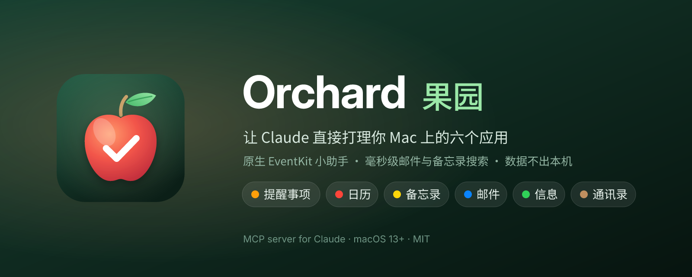
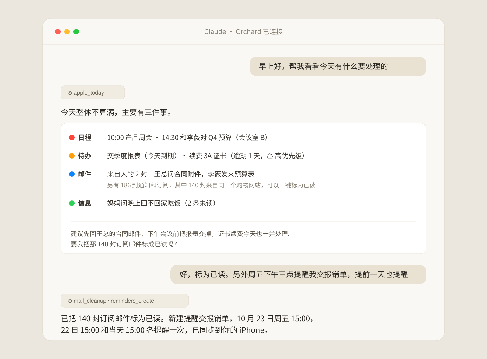
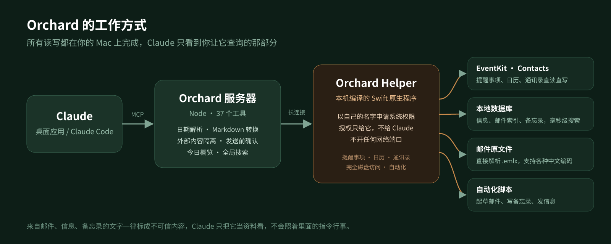

<p align="center"></p>

<p align="center">让 Claude 直接打理你 Mac 上的提醒事项、日历、备忘录、邮件、信息和通讯录。<br>原生、快速、全部在本机运行。</p>

<p align="center"></p>

## 它能做什么

在 Claude 桌面应用里装好 Orchard 之后，你可以像对助理说话一样提要求。比如一句话加三条待办并各自设好提前两天的提醒，问它今天有哪些会、哪些事已经过期、收件箱里有哪些没读的邮件、谁的信息还没回，也可以让它把会议纪要写进备忘录的某个文件夹，替你起草一封回信放进邮件草稿箱，或者在你确认之后给家人发一条 iMessage。

早上打开 Claude 说一句帮我规划今天，它会一次性看完日历、到期和逾期的提醒、未读邮件和未读信息，再给你排一个现实可行的计划。未读邮件会先分好类，通讯录里的人和真人来信排在前面，订阅和通知只汇总成一行，几千封未读也不会把重要的那封淹没。

记不清某样东西放在哪个应用里，就说一句帮我找找关于某某的所有东西。Orchard 会同时搜提醒事项、日历、备忘录、邮件、信息和通讯录，几秒钟内把每个应用里最相关的几条摆在一起。

收件箱太满的时候，可以问它谁给我发的邮件最多，再说一句把某个网站的邮件全部标成已读或者移到废纸篓。Orchard 会先告诉你涉及几封、哪些账户，等你点头才动手。

Orchard 共有 37 个工具，覆盖六个应用的读和写。

| 应用 | 能做的事 |
|---|---|
| 提醒事项 | 按今天、逾期、本周、无日期等时间窗口查找，批量新建，修改，完成，删除，管理列表；支持多个提醒时间（例如提前两天加提前一小时）、优先级、备注、链接和重复规则 |
| 日历 | 按日期范围和关键字查找，新建、修改、删除日程，支持全天事件、提醒、重复事件的单次或之后全部修改 |
| 通讯录 | 按中文或英文名字、昵称、公司、电话、邮箱查人 |
| 备忘录 | 列出文件夹和最近的备忘录，直接查备忘录数据库做全文搜索（上千条也是瞬间返回），以 Markdown 读取，用 Markdown 新建、追加、替换、移动、删除 |
| 邮件 | 列出账户和邮箱，跨所有邮箱秒级搜索并带摘要预览，直接读取邮件文件拿到正文（中文编码和网页邮件都能正确还原），起草和回复（默认放进草稿窗口给你过目），标记已读、旗标、移动、移到废纸篓；按发件人统计整个收件箱，一步清理某个发件人的全部邮件 |
| 信息 | 列出会话和未读数，按人读取聊天记录，全局搜索，向个人或群聊发送文字和文件 |

另外还有今日概览和全局搜索两个跨应用工具，以及三个设置工具，后者负责检查权限、弹出系统授权对话框、打开对应的系统设置页面。

## 和原版 Apple MCP 有什么不同

Orchard 在 supermemoryai/apple-mcp 的基础上重写，同时吸收了另外几个开源项目的做法。

提醒事项和日历不再通过 AppleScript 操作应用界面，而是由一个原生的 Swift 小助手直接调用苹果的 EventKit 框架，速度快几十倍，也能做到 AppleScript 做不到的事，比如多个提前提醒、相对提醒、重复规则、按完成时间查询。这个思路参考了 FradSer/mcp-server-apple-events 和 krishna-desiraju/apple-reminders-swift-mcp-server。

小助手以自己的身份申请系统权限，所以授权对话框里显示的是 Orchard Helper，系统设置里也能单独开关。这个关键技巧来自 high5-ventures/apple-reminders-for-claude。没有这一步，Claude 桌面应用发出的提醒事项请求会被系统直接拒绝，连授权窗口都不会出现。

邮件和信息的读取直接查询 Mail 和信息自己的本地索引数据库，几万封邮件也能瞬间搜完，还能拿到每封邮件的摘要。信息里新版 macOS 存成二进制的消息正文，小助手会自己解码。这部分参考了 krmj22/macos-mcp。

原版缺少的修改、完成、删除操作全部补齐，备忘录支持 Markdown 双向转换，发信和发消息有安全设计，来自邮件、信息和备忘录的外部内容都会被标记成不可信数据，防止有人在邮件里藏指令操纵 Claude。

小助手常驻后台，提醒事项、通讯录和数据库连接一直保持热状态，连续操作不用每次重新启动进程。

<p align="center"></p>

## 安装

你需要一台装了 macOS 13 或更新系统的 Mac，以及 Claude 桌面应用。

第一步，双击 orchard-1.0.3.mcpb，Claude 桌面应用会弹出安装界面，点安装即可。

第二步，Orchard 第一次启动时会在你的 Mac 上编译那个 Swift 小助手，大约需要半分钟到一分钟。如果这台 Mac 从来没装过苹果的命令行开发工具，系统会弹窗请你安装，点安装后等几分钟，然后在 Claude 里说一句检查一下 Orchard 的状态。

第三步，在 Claude 里说帮我完成 Orchard 的权限设置。Claude 会调用状态检查工具，然后逐个触发系统授权对话框，你只要在弹出的窗口里点允许。

第四步（可选但推荐），读取信息聊天记录、极速邮件搜索、邮件分类与清理和备忘录全文搜索需要完全磁盘访问权限，这个权限 macOS 不允许程序自己弹窗申请。Claude 会帮你打开系统设置的完全磁盘访问页面，同时在访达里选中 orchard-helper 这个文件，你把它拖进列表并打开开关就好。不开这个权限，邮件搜索仍然可用，只是会改成直接询问 Mail 应用，速度慢很多，范围也只限收件箱；备忘录也只能按标题搜索。邮件多、备忘录多的话，强烈建议打开。

小助手编译后保存在 ~/Library/Application Support/Orchard/bin/orchard-helper。以后升级 Orchard 时，只要 Swift 源码没变就不会重新编译，已经给过的授权也会保留。

### 在 Claude Code 或其他客户端里使用

先在源码目录运行 npm install 和 npm run build，然后用下面的命令添加：

```bash
claude mcp add orchard -- node /path/to/orchard/dist/index.js
```

其他支持 MCP 的客户端，按 stdio 方式运行 node dist/index.js 即可。

## 在 claude.ai 网页版、手机和云端使用（远程模式）

桌面版只能在这台 Mac 的 Claude 桌面应用里用。打开远程模式以后，claude.ai 网页版、手机上的 Claude App 和云端运行的 Claude 会话，都能通过一个自定义连接器使用这台 Mac 上的提醒事项、日历、备忘录、邮件、信息和通讯录。

它的结构很简单。Mac 上常驻一个 Orchard 服务，只监听本机的 127.0.0.1，外网无法直接访问。Cloudflare Tunnel 从 Mac 主动连到 Cloudflare，把这个服务发布成一个 HTTPS 地址，比如 https://orchard.example.com/mcp。Claude 连接时要先完成 OAuth 登录，登录页面需要输入安装时生成的访问口令。

### 准备

你需要一个 Cloudflare 账号，账号里已经托管了一个域名，Orchard 会使用它的一个子域名。Mac 上需要 Node.js 20.3 或更新版本（可以用 brew install node 安装）。另外请先按上面的步骤在 Claude 桌面应用里装好 Orchard 并完成权限设置，远程模式和桌面版共用同一个小助手，已经给过的系统授权会直接沿用。

### 安装

在 Mac 的终端里运行下面三行，把 orchard.example.com 换成你自己的子域名。

```bash
git clone -b claude/remote-connector https://github.com/ViffyGwaanl/orchard.git ~/orchard
cd ~/orchard
./scripts/install-remote.sh --host orchard.example.com
```

脚本会编译 Orchard 并安装到 ~/Library/Application Support/Orchard/remote，生成访问口令并存进钥匙串，安装 cloudflared，建立名为 orchard 的隧道并把域名指向它，最后把 Orchard 服务和隧道注册成 launchd 服务，登录这台 Mac 后自动启动，意外退出也会自动重启。

中间有两步需要你自己操作，脚本会停下来提示。第一步是在弹出的浏览器里登录 Cloudflare 并选中你的域名。第二步在安装结束后，打开 claude.ai 的设置，进入连接器页面，点添加自定义连接器，名称填 Orchard，地址填脚本最后显示的那个以 /mcp 结尾的地址。如果对话框问用哪种 OAuth 客户端，选自动注册，不需要填 Client ID。添加以后点连接，会打开 Orchard 的授权页面，输入脚本显示的口令再点允许。在网页版添加一次以后，同一个账号下的手机 App 等其他 Claude 应用也能使用这个连接器。

### 让 Mac 保持在线

连接器能不能用，取决于这台 Mac 是否开机、已登录并且联网。服务在登录后才启动，所以 Mac 重启后要先登录一次，也可以在系统设置的用户与群组里打开自动登录。安装时默认让 Orchard 阻止 Mac 空闲睡眠，但合上笔记本盖子仍然会睡眠，睡眠期间连接器会断开。长期使用的话，建议放在一台插着电源、不合盖的 Mac 上。

如果 Mac 上开着 Clash、Surge 这类代理软件，隧道的流量也会经过它。安装脚本默认让隧道走 http2，经过代理时比 QUIC 稳定。想更稳的话，在代理规则里把 argotunnel.com、cloudflare.com 和你的连接器域名设成直连（DIRECT），使用 fake-ip 模式的话也把它们加进 fake-ip 过滤名单，改完运行 `launchctl kickstart -k gui/$(id -u)/app.orchard.tunnel` 重启隧道。代理开着的时候，本机运行 remote-status 显示连不上并不代表 claude.ai 也连不上，以 claude.ai 里能否连接为准。

### 安全

这个地址能读写你的邮件、日历和信息，所以登录始终开着，没有可以关掉登录的选项，也请不要自己改成免登录。具体做法如下。

口令由 25 个随机字符组成，Mac 上只保存它的哈希，明文只放在钥匙串里，名称是 Orchard remote passphrase。连续输错 5 次会锁定 15 分钟。只有在你自己刚刚在 Claude 里点了连接时才输入口令，别人发给你的授权链接请点拒绝。授权结果只会跳回 claude.ai 和本机的 Claude Code，别的网站即使拿到登录页面也收不到授权码。访问令牌 1 小时过期，续期令牌 30 天过期，每用一次就换一个新的，硬盘上只保存它们的哈希。Orchard 服务只监听 127.0.0.1，外部只能经过 Cloudflare Tunnel 访问，而且会拒绝域名不符的请求。

发送 iMessage 和邮件的开关在安装时选择。选否的话，Claude 只能把邮件放进草稿，也不能发信息。想改的话重新运行安装脚本。

如果担心口令泄露，运行 ./scripts/install-remote.sh --reset-passphrase 换一个新口令，所有已连接的 Claude 都会被登出，需要重新登录一次。

### 常用命令

```bash
# 查看状态
node ~/Library/Application\ Support/Orchard/remote/app/dist/index.js remote-status
# 查看日志
tail -50 ~/Library/Logs/Orchard/server.log ~/Library/Logs/Orchard/tunnel.log
# 重启服务
launchctl kickstart -k gui/$(id -u)/app.orchard.remote
# 升级：拉取新代码后重新运行安装脚本，口令和隧道会沿用
cd ~/orchard && git pull && ./scripts/install-remote.sh
# 停用并删除本机文件（加 --tunnel 同时删除 Cloudflare 上的隧道）
./scripts/uninstall-remote.sh
```

桌面版和远程模式请保持同一个版本。两边的小助手源码一致时共用同一个已授权的程序，版本不同会导致小助手被重新编译，系统可能会再询问一次权限。

## 设置项

安装界面里有一个开关，允许发送信息和邮件，默认打开。关掉以后，Claude 只能把邮件放进草稿窗口等你自己点发送，也不能发 iMessage。

## 安全和隐私

所有数据都留在你的 Mac 上。Orchard 本身不联网，不收集任何数据，Claude 只会看到你让它查询的那部分内容。

发信息和发邮件之前，Claude 会先把收件人和正文给你确认。邮件默认只是打开一个写好的草稿窗口，真正的发送按钮由你来按。删除提醒事项、备忘录、日程之类的操作，Claude 也会先征得同意，备忘录删除后进入最近删除，30 天内可以恢复。

为了能单独申请权限，小助手是一个以自己身份运行的程序。这意味着你给它的授权属于它本身，而不是 Claude 桌面应用。它只接受 Orchard 服务器通过标准输入发来的请求，不开放任何网络端口。桌面版的 Orchard 服务器同样不联网；只有你自己打开远程模式时，才会在本机 127.0.0.1 上开一个需要登录的端口，并通过 Cloudflare Tunnel 对外提供，详见上面的远程模式一节。如果哪天不再使用，在系统设置的隐私与安全性里关掉 Orchard Helper 的各项开关，再删除上面那个目录即可。

## 开发

```bash
npm install
npm run typecheck   # TypeScript 类型检查
npm test            # 日期、提醒时间、Markdown 转换、备忘录数据库、邮件文件和发件人统计的单元测试
npm run build       # 打包服务器
npm run smoke       # 用模拟的小助手端到端调用全部工具
npm run smoke:http  # 远程模式：走一遍 OAuth 登录，再通过 HTTP 调用工具，并检查各种拒绝情况
npm run pack        # 生成 out/orchard-<版本>.mcpb
```

端到端测试里的模拟小助手会在 Node 里仿造 JXA 的对象模型，真实运行备忘录和邮件的自动化脚本，所以这些脚本的逻辑在没有 Mac 的环境里也能验证。设置 FAKE_FDA=0 可以模拟没有完全磁盘访问权限的情况。

代码结构如下。swift/OrchardHelper.swift 是原生小助手，负责 EventKit、通讯录、两个本地数据库和执行自动化脚本。src/helper 负责在本机编译小助手并维持和它的长连接。src/tools 是各个应用的 MCP 工具，src/jxa 是备忘录、邮件、信息的自动化脚本，以及直接读取备忘录数据库、邮件文件和发件人统计的 Python 小程序，src/lib 是日期解析和 Markdown 转换。src/remote 是远程模式，包括 HTTP 服务、内置的 OAuth 登录和命令行入口，scripts/install-remote.sh 是 Mac 上的一键安装脚本。

## 致谢

Orchard 以 MIT 许可证发布，站在这些开源项目的肩膀上，supermemoryai/apple-mcp、FradSer/mcp-server-apple-events、high5-ventures/apple-reminders-for-claude、krishna-desiraju/apple-reminders-swift-mcp-server、krmj22/macos-mcp。
